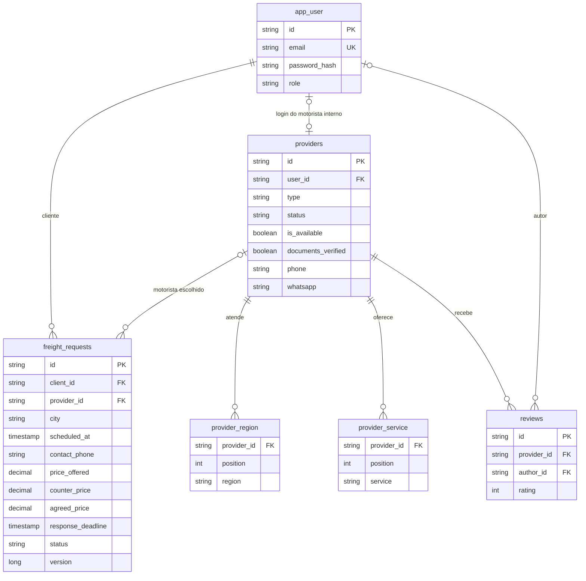

# FreteHub — Documentacao tecnica

Este documento explica como o FreteHub funciona por dentro: o que cada parte
faz, por que foi feita assim e como as partes conversam. A ideia e que qualquer
pessoa da equipe consiga abrir o codigo, entender onde mexer e nao quebrar o
que ja funciona.

Sumario

1. [O que e o FreteHub](#1-o-que-e-o-fretehub)
2. [Visao geral da arquitetura](#2-visao-geral-da-arquitetura)
3. [Como rodar](#3-como-rodar)
4. [Configuracao e variaveis de ambiente](#4-configuracao-e-variaveis-de-ambiente)
5. [Backend (API)](#5-backend-api)
6. [Banco de dados](#6-banco-de-dados)
7. [Seguranca e autenticacao](#7-seguranca-e-autenticacao)
8. [Referencia da API](#8-referencia-da-api)
9. [Frontend](#9-frontend)
10. [Fluxos de ponta a ponta](#10-fluxos-de-ponta-a-ponta)
11. [Testes](#11-testes)
12. [Pontos de atencao e limitacoes conhecidas](#12-pontos-de-atencao-e-limitacoes-conhecidas)
13. [Glossario](#13-glossario)

---

## 1. O que e o FreteHub

O FreteHub combina um **catalogo com curadoria** e o aceite de pedidos de
frete no app, com demonstracao na Baixada Santista.

O problema que ele resolve: hoje quem precisa de um frete procura em grupos de
WhatsApp e classificados, sem saber se o motorista e confiavel e sem nenhum
registro do que foi pedido. O FreteHub faz tres coisas:

- **Valida quem aparece.** So motoristas aprovados pela equipe entram no
  catalogo publico.
- **Guarda o pedido.** O cliente informa origem, destino, data e horario,
  carga, telefone e valor oferecido, e acompanha o status.
- **Encaminha o pedido.** Motoristas do app aceitam, recusam ou contrapropoem
  um valor. Motoristas de contato direto recebem o cliente fora do app.

O FreteHub registra a oferta e o valor acordado, mas nao processa pagamento.
Depois do aceite, cliente e motorista conversam diretamente para alinhar o
servico. No modelo de contato direto, toda a conversa ocorre fora do app.

Existem tres papeis com login:

| Papel       | Quem e                      | O que pode fazer                                                |
| ----------- | --------------------------- | --------------------------------------------------------------- |
| `CLIENTE`   | Quem precisa de um frete    | Abrir pedidos, responder a contrapropostas, acompanhar, avaliar |
| `MOTORISTA` | Motorista que recebe no app | Definir disponibilidade, responder a pedidos e executar fretes  |
| `ADMIN`     | A equipe do FreteHub        | Curadoria, moderacao e apoio a pedidos antigos                  |

O perfil `INTERNO` pertence a uma conta `MOTORISTA`. O perfil `EXTERNO` e um
cadastro sem login. Os dois passam pela mesma curadoria.

---

## 2. Visao geral da arquitetura

A aplicacao tem tres pecas:

```
 Navegador                     Servidor                      Banco
┌──────────────────┐  /api   ┌─────────────────────┐  JDBC  ┌──────────────┐
│ Frontend React   │ ──────▶ │ API Spring Boot     │ ─────▶ │ PostgreSQL 16│
│ (Vite, :5173)    │ ◀────── │ (:8080)             │ ◀───── │ (fretehub)   │
└──────────────────┘  JSON   └─────────────────────┘        └──────────────┘
```

- **Frontend** — a interface que o usuario ve. Escrita em React + TypeScript,
  roda no navegador. Nao guarda dados de negocio; pede tudo para a API.
- **API (backend)** — o "cerebro". Recebe as requisicoes, aplica as regras
  (quem pode o que, quais status sao validos) e le/grava no banco.
- **Banco** — PostgreSQL, onde ficam usuarios, motoristas, avaliacoes e
  pedidos de frete.

Frontend e API se comunicam por **HTTP com JSON**. Toda rota da API comeca com
`/api`. Em desenvolvimento, o Vite (servidor do front) funciona como
**proxy**: quando o navegador chama `http://localhost:5173/api/...`, o Vite
repassa para `http://localhost:8080/api/...`. Isso evita problemas de CORS e
deixa o front chamar sempre o caminho relativo `/api`.

Na versao publicada (secao 3.1) nao ha Vite: o front e um site estatico em um
endereco e a API fica em outro. O build do front recebe a URL da API em
`VITE_API_URL`, e a API libera o endereco do site no CORS
(`CORS_ALLOWED_ORIGINS`).

### Tecnologias

| Camada          | Tecnologia                         | Para que serve                                         |
| --------------- | ---------------------------------- | ------------------------------------------------------ |
| Interface       | React 18 + TypeScript              | Componentes de tela tipados                            |
| Build do front  | Vite 5                             | Servidor de desenvolvimento rapido e build de producao |
| Estilo          | Tailwind CSS v4                    | Classes utilitarias de CSS                             |
| Icones          | Phosphor Icons                     | Icones SVG como componentes React                      |
| Fonte           | Plus Jakarta Sans (Fontsource)     | Fonte da interface, servida pelo proprio app           |
| Rotas do front  | React Router v6                    | Navegacao entre paginas sem recarregar                 |
| Dados no front  | TanStack React Query v5            | Busca, cache e atualizacao dos dados da API            |
| API             | Spring Boot 3.5 (Java 21+)         | Servidor web, regras de negocio                        |
| Persistencia    | Spring Data JPA / Hibernate        | Mapeia classes Java para tabelas                       |
| Migrations      | Flyway                             | Cria e evolui o schema do banco de forma versionada    |
| Banco           | PostgreSQL 16                      | Armazenamento                                          |
| Autenticacao    | JWT (jjwt 0.12) + BCrypt           | Login sem sessao no servidor; senha com hash           |
| Testes          | JUnit 5, MockMvc, H2               | Testes de API sem precisar de banco externo            |

---

## 3. Como rodar

Pre-requisitos: Node.js, Java 21 ou mais recente e PostgreSQL 16.

**Banco (uma vez so):**

```bash
brew services start postgresql@16
createuser -s fretehub
psql -d postgres -c "ALTER USER fretehub WITH PASSWORD 'fretehub';"
createdb -O fretehub fretehub
```

**API** (terminal 1):

```bash
export JAVA_HOME=$(/usr/libexec/java_home)   # se o java nao estiver no PATH
cd backend
./mvnw spring-boot:run
```

Na subida, o Flyway cria ou atualiza as tabelas e, se a tabela de usuarios
estiver vazia, o seed carrega as contas, motoristas e fretes de demonstracao.

**Frontend** (terminal 2, na raiz do projeto):

```bash
npm install
npm run dev        # http://localhost:5173
```

**Rodar a API em outra porta** (ex.: a 8080 esta ocupada):

```bash
SERVER_PORT=8081 ./mvnw spring-boot:run                 # em backend/
VITE_PROXY_TARGET=http://localhost:8081 npm run dev     # na raiz
```

**Contas de demonstracao:**

| Perfil                           | E-mail                 | Senha        |
| -------------------------------- | ---------------------- | ------------ |
| Admin                            | admin@fretehub.com     | admin123     |
| Cliente                          | cliente@fretehub.com   | cliente123   |
| Motorista aprovado, disponivel   | motorista@fretehub.com | motorista123 |
| Motorista aprovado, indisponivel | ana@fretehub.com       | motorista123 |
| Motorista pendente               | pedro@fretehub.com     | motorista123 |

**Outros comandos:**

| Comando                     | O que faz                                   |
| --------------------------- | ------------------------------------------- |
| `npm run build`             | Checa tipos e gera o build de producao      |
| `npm run lint`              | Checa tipos (`tsc --noEmit`)                |
| `npm run preview`           | Serve o build localmente                    |
| `cd backend && ./mvnw test` | Roda os testes de API                       |

### 3.1 Publicar (Render + Neon)

A versao online usa tres pecas gratuitas: dois servicos no Render, descritos em
[`render.yaml`](../render.yaml), e o banco no Neon.

```
 Navegador
    │
    ├─ https://fretehub-web.onrender.com ──▶ fretehub-web (site estatico)
    │                                          build do front, nunca dorme
    │
    └─ https://fretehub-api.onrender.com/api ──▶ fretehub-api (Docker)
                                                   │ dorme apos 15 min
                                                   ▼
                                                Neon (PostgreSQL)
```

- **`fretehub-web`** — o Render roda `npm run build` e publica o `dist/`.
  Rotas do React Router (`/catalogo`, `/motorista/...`) nao sao arquivos: uma
  regra de rewrite as manda para o `index.html`, e o front resolve a tela.
- **`fretehub-api`** — o Render gera a imagem do
  [`backend/Dockerfile`](../backend/Dockerfile) e roda o jar.
- **Neon** — guarda o PostgreSQL. O banco free do Render expira em 30 dias; o
  do Neon e permanente (1 GB por projeto).

Os dois servicos se encontram pela URL publica: o site recebe
`VITE_API_URL=https://fretehub-api.onrender.com` no build, e a API recebe
`CORS_ALLOWED_ORIGINS=https://fretehub-web.onrender.com`. Se o Render der outro
endereco a algum deles (nome ja usado por outra conta), ajuste essas duas
linhas do `render.yaml`.

**Passo a passo (uma vez so):**

1. No [Neon](https://neon.com), crie um projeto na regiao **AWS US East
   (N. Virginia)**, a mesma da API. Em **Connect**, copie a connection string
   (`postgresql://...neon.tech/neondb?sslmode=require...`).
2. No [Render](https://render.com), entre com o GitHub e va em **New →
   Blueprint**. Escolha este repositorio; o Render le o `render.yaml`.
3. Cole a connection string do Neon no campo `DATABASE_URL` e confirme.
   `JWT_SECRET` e gerado pelo proprio Render.
4. Aguarde os dois deploys (alguns minutos). Na primeira subida da API, o
   Flyway cria as tabelas no Neon e o seed carrega as contas de demonstracao.

O [`backend/docker-start.sh`](../backend/docker-start.sh) converte a
`DATABASE_URL` nas variaveis `DB_URL`, `DB_USER` e `DB_PASSWORD` que o perfil
`prod` exige. Se o endereco copiado for o do pooler (`-pooler`), ele troca pela
conexao direta, porque o Flyway nao funciona bem atras do PgBouncer e a API ja
tem o Hikari como pool. Cada push na `main` gera um novo deploy. Mantenha o
Blueprint que gerencia `fretehub-api` e `fretehub-web`; o Blueprint duplicado
com servicos terminados em `-y6sg` precisa ser desconectado antes de publicar.

**Limites do plano gratuito:**

| Servico        | Limite                                                                 |
| -------------- | ---------------------------------------------------------------------- |
| `fretehub-web` | Servido por CDN; nao dorme                                             |
| `fretehub-api` | 512 MB e 0,1 CPU; dorme apos 15 min sem acesso e leva 1 a 2 min para acordar |
| Neon           | 1 GB; o banco pausa apos 5 min sem uso e volta sozinho na consulta seguinte |

Com a API dormindo, o site abre na hora, mas os dados demoram a aparecer ate
ela acordar. Antes de uma apresentacao, abra o link alguns minutos antes.

---

## 4. Configuracao e variaveis de ambiente

Nenhum segredo fica no codigo. A API le tudo de variaveis de ambiente, com
valores padrao apenas para o desenvolvimento local. O arquivo
[`.env.example`](../.env.example) lista todas.

| Variavel                 | Padrao em dev                                 | Em producao                  |
| ------------------------ | --------------------------------------------- | ---------------------------- |
| `SPRING_PROFILES_ACTIVE` | `dev`                                         | `prod`                       |
| `SERVER_PORT`            | `8080`                                        | conforme o ambiente          |
| `DB_URL`                 | `jdbc:postgresql://localhost:5432/fretehub`   | **obrigatoria**              |
| `DB_USER`                | `fretehub`                                    | **obrigatoria**              |
| `DB_PASSWORD`            | `fretehub`                                    | **obrigatoria**              |
| `DATABASE_URL`           | —                                             | no container, substitui as tres acima (secao 3.1) |
| `CORS_ALLOWED_ORIGINS`   | `http://localhost:5173,http://127.0.0.1:5173` | URL do site publicado        |
| `JWT_SECRET`             | vazio → chave efemera gerada na subida        | **obrigatoria**, 32+ caracteres |
| `JWT_EXPIRATION_HOURS`   | `12`                                          | opcional                     |
| `FREIGHT_RESPONSE_MINUTES` | `30`                                       | opcional                     |
| `VITE_PROXY_TARGET`      | `http://localhost:8080` (usada pelo Vite)     | —                            |
| `VITE_API_URL`           | vazio (usa `/api` relativo)                   | URL da API, no build do site |

### Perfis

Um **perfil** do Spring e um conjunto de configuracoes ativado por nome.

- **`dev`** (padrao) — usa `application.yml`. Tem defaults para o banco local.
  Se `JWT_SECRET` nao for definido, a API gera uma chave aleatoria a cada
  subida e avisa no log. Consequencia pratica: **ao reiniciar a API, todo
  mundo precisa logar de novo**. Para evitar isso, defina `JWT_SECRET`.
- **`prod`** — soma `application-prod.yml`, que remove os defaults do banco.
  A API **nao sobe** se faltar `DB_URL`, `DB_USER`, `DB_PASSWORD` ou
  `JWT_SECRET`. Isso e proposital: e melhor falhar na subida do que rodar em
  producao com senha de exemplo.
- **`test`** — usado so pelos testes (`src/test/resources/application-test.yml`).
  Troca o PostgreSQL por um H2 em memoria.

---

## 5. Backend (API)

Codigo em `backend/src/main/java/com/fretehub/`. A organizacao e **por
assunto** (cada pasta e uma parte do negocio), e nao por tipo de classe.

```
com/fretehub/
├── FreteHubApplication.java   # ponto de entrada
├── config/SecurityConfig.java # regras de acesso, CORS, BCrypt
├── config/CorsProperties.java # enderecos do front liberados no CORS
├── security/                  # JWT e usuario logado
├── user/                      # contas e login de cliente/motorista
├── provider/                  # motoristas, curadoria e avaliacoes
├── freight/                   # pedidos de frete e fluxo de aceite
├── domain/Enums.java          # listas fixas de valores (status, veiculos...)
├── web/                       # DTOs e tratamento de erros
└── seed/DemoDataLoader.java   # dados de demonstracao
```

### 5.1 As camadas de cada assunto

Cada assunto segue o mesmo padrao de tres camadas. Usando motoristas como
exemplo:

```
Requisicao HTTP
      │
      ▼
ProviderController   ← recebe a requisicao, extrai parametros, devolve JSON
      │
      ▼
ProviderService      ← regras de negocio e validacoes; abre a transacao
      │
      ▼
ProviderRepository   ← le e grava no banco (Spring Data gera a implementacao)
      │
      ▼
ProviderProfile      ← entidade: a classe que espelha a tabela "providers"
```

- **Controller** — so traduz HTTP para chamada Java. Nao tem regra.
- **Service** — onde mora a logica: "o nome e obrigatorio", "so aprovados
  aparecem no catalogo", "nao pode pular status". E aqui que ficam as
  anotacoes `@Transactional`.
- **Repository** — interface que estende `JpaRepository`. O Spring gera as
  consultas a partir do nome do metodo, por exemplo
  `findByStatus(ProviderStatus status)` vira
  `select ... from providers where status = ?`.
- **Entidade** — classe anotada com `@Entity`; cada campo e uma coluna.

### 5.2 DTOs: o que entra e o que sai

As entidades **nunca** sao devolvidas direto no JSON. Em vez disso, o service
converte para um **DTO** (objeto de transferencia), definido em
[`web/Dtos.java`](../backend/src/main/java/com/fretehub/web/Dtos.java) como
`record` Java.

Convencao de nomes:

- `...Input` — o que o cliente envia (ex.: `ProviderInput`, `FreightInput`).
- `...View` — o que a API devolve (ex.: `ProviderView`, `FreightView`).

Por que separar: a entidade tem detalhes internos (hash de senha, relacoes
com carregamento preguicoso) que nao devem vazar. O DTO e o **contrato** com o
front, e e exatamente o que `src/lib/types.ts` espelha.

### 5.3 Transacoes e carregamento preguicoso

O projeto usa `spring.jpa.open-in-view: false`. Em termos simples: a conexao
com o banco fica aberta **apenas durante o metodo do service**, nao durante a
requisicao inteira.

Isso importa porque algumas relacoes sao `LAZY` (carregadas so quando
acessadas), como o cliente e o motorista de um frete. Por isso, todos os
metodos de service que montam um `...View` tem `@Transactional` — a conversao
para DTO acontece **dentro** da transacao. Se voce criar um metodo novo que le
uma relacao e esquecer o `@Transactional`, vai ver um
`LazyInitializationException`. Os metodos que leem pedidos podem expirar
prazos vencidos; portanto, essas leituras usam transacao com escrita.

Outra consequencia util: dentro de um metodo `@Transactional`, alterar um
campo de uma entidade carregada (ex.: `freight.setStatus(...)`) ja grava no
banco ao final do metodo, sem precisar chamar `save`.

### 5.4 Enums (valores fixos)

[`domain/Enums.java`](../backend/src/main/java/com/fretehub/domain/Enums.java)
concentra as listas fechadas. Sao gravadas no banco como texto
(`EnumType.STRING`), entao **renomear um valor exige migration** para
atualizar os dados existentes.

| Enum             | Valores                                                                                         |
| ---------------- | ----------------------------------------------------------------------------------------------- |
| `VehicleType`    | MOTO, CARRO, FIORINO, VAN, CAMINHAO_PEQUENO, CAMINHAO_BAU                                       |
| `ServiceTag`     | FRETE_PEQUENO, MUDANCA_RESIDENCIAL, MUDANCA_COMERCIAL, ENTREGA_EXPRESSA, CARGA_FRAGIL, MONTAGEM_MOVEIS, AJUDANTE_CARGA |
| `ProviderStatus` | PENDENTE, APROVADO, REJEITADO, INATIVO                                                          |
| `ProviderType`   | INTERNO, EXTERNO                                                                                 |
| `FreightStatus`  | PENDENTE, CONTRAPROPOSTA, ACEITO, RECUSADO, EXPIRADO, EM_ANDAMENTO, CONCLUIDO, CANCELADO        |
| `UserRole`       | CLIENTE, MOTORISTA, ADMIN                                                                       |

Os mesmos valores existem em `src/lib/types.ts`, junto com os rotulos de tela
(`VEHICLE_LABELS`, `SERVICE_LABELS`...). **Ao adicionar um valor, atualize os
dois lados.**

### 5.5 Modulo `user` — contas e login

- **`UserAccount`** (tabela `app_user`) — id, nome, e-mail (unico), hash da
  senha e papel.
- **`AuthService.register`** — cria sempre um `CLIENTE`. Valida nome, e-mail
  (precisa ter `@`), senha com 6+ caracteres e e-mail ainda nao usado
  (senao, `409 Conflict`). A senha e guardada com **BCrypt** — um hash lento
  e com "sal", de forma que nem quem tem acesso ao banco descobre a senha.
- **`AuthService.login`** — busca o usuario pelo e-mail (sem diferenciar
  maiusculas), compara a senha com o hash e devolve `{ user, token }`. E-mail
  inexistente e senha errada dao a **mesma** mensagem, para nao revelar quais
  e-mails tem conta.
- Contas `ADMIN` nao sao criadas pela API; vem do seed (ou direto no banco).
- **`AuthService.registerDriver`** — cria, na mesma transacao, uma conta
  `MOTORISTA` e um perfil `INTERNO` `PENDENTE`. Exige WhatsApp ou telefone,
  alem dos dados normais do perfil. O e-mail e unico entre todos os papeis;
  repeticao devolve `409`. O cadastro retorna `{ user, token }`.

### 5.6 Modulo `provider` — motoristas, curadoria e avaliacoes

**Entidade `ProviderProfile`** (tabela `providers`):

| Campo                           | Significado                                                  |
| ------------------------------- | ------------------------------------------------------------ |
| `name`, `headline`, `bio`       | Nome, chamada curta do card e descricao longa                |
| `photoUrl`                      | URL da foto. Se vazio no cadastro, usa uma foto padrao       |
| `vehicleType`, `vehicleDescription` | Tipo e descricao livre do veiculo                        |
| `regions`                       | Lista de bairros/cidades (tabela `provider_region`)          |
| `services`                      | Lista de servicos (tabela `provider_service`)                |
| `contacts`                      | Telefone, WhatsApp e e-mail (colunas na propria tabela)      |
| `status`                        | Situacao na curadoria                                        |
| `documentNote`                  | Observacao interna da equipe (ex.: "CNH validada")           |
| `reviews`                       | Avaliacoes (tabela `reviews`)                                |
| `type`                          | `INTERNO` (com login) ou `EXTERNO` (contato direto)           |
| `user`                          | Conta `MOTORISTA` do perfil interno; nulo no externo         |
| `available`                     | Disponibilidade para receber novos pedidos no app            |
| `documentsVerified`             | Conferencia de CNH e CRLV pela equipe                        |

`regions` e `services` sao `@ElementCollection`: listas simples guardadas em
tabelas auxiliares, com uma coluna `position` para manter a ordem. `contacts`
e um `@Embeddable` (`ContactInfo`): os tres campos viram colunas da propria
tabela `providers`; valores em branco viram `null`.

**Cadastro (`create`)** — aberto ao publico pela pagina "Seja um motorista".
Exige nome, chamada, tipo de veiculo, ao menos uma regiao, ao menos um
servico e ao menos um canal de contato. **Sempre entra como `PENDENTE`**,
seja qual for o valor enviado. Sem a opcao "Receber pedidos pelo app", cria um
perfil `EXTERNO` sem login. Com a opcao marcada, usa `register-driver` e cria
um perfil `INTERNO` vinculado a uma conta, tambem `PENDENTE`.

**Curadoria (`updateStatus`)** — so `ADMIN`. Muda o status e, opcionalmente,
a observacao interna (`documentNote`; texto vazio apaga a nota). Aprovar marca
`documentsVerified=true`, pois a equipe confere CNH e CRLV. Sair de
`APROVADO` desliga `available`. Os quatro status:

| Status      | Significado                       | Aparece no catalogo? | Recebe pedido? |
| ----------- | --------------------------------- | -------------------- | -------------- |
| `PENDENTE`  | Aguardando analise                | Nao                  | Nao            |
| `APROVADO`  | Validado pela equipe              | **Sim**              | So se `INTERNO` e disponivel |
| `REJEITADO` | Nao passou na curadoria           | Nao                  | Nao            |
| `INATIVO`   | Ja foi aprovado, foi desativado   | Nao                  | Nao            |

**Catalogo publico (`listPublic`)** — le os motoristas `APROVADO` e aplica os
filtros **em memoria**, em Java:

- `vehicleType` e `service`: comparacao exata com o enum.
- `region`: "contem", ignorando acentos e maiusculas (ex.: `sao vicente`
  encontra `Sao Vicente`).
- `search`: "contem" sobre nome + chamada + bio + regioes, tambem ignorando
  acentos e maiusculas.
- `type`, `available` e `city`: forma de contratacao, disponibilidade e cidade.

Depois ordena por nome e corta a pagina pedida. `page` comeca em 1;
`pageSize` padrao e 9 e maximo 50. A resposta traz `items`, `total`, `page` e
`pageSize`. Filtrar em memoria e simples e atende o volume atual; ver a
secao 12.

**Perfil (`get`)** — para o publico (e para clientes logados), so existe
motorista `APROVADO`: qualquer outro status responde `404`, igual a um id
inexistente, para nao revelar cadastros pendentes ou rejeitados. Se quem pede
e um `ADMIN` logado, a API devolve o perfil em qualquer status — e assim que o
painel deixa a equipe pre-visualizar um cadastro pendente.

**Contatos.** O catalogo e o perfil publico mostram os canais de contato do
`EXTERNO`. Para `INTERNO`, os campos de contato ficam vazios no catalogo e no
perfil publico, inclusive para clientes logados. O proprio motorista e o admin
veem seus dados. Depois do aceite de um pedido, o cliente recebe telefone e
WhatsApp do motorista, e o motorista recebe telefone e e-mail do cliente no
`FreightView`. O id e o e-mail da conta vinculada nao saem no perfil publico.

**Nota interna (`documentNote`)** — so sai nas respostas para a equipe:
`/api/admin/providers`, o `PATCH` de curadoria e o perfil pedido por um
`ADMIN`. Catalogo, perfil publico, cadastro e avaliacao nunca a incluem. No
codigo, isso e a diferenca entre `toPublicView` e `toAdminView` no
`ProviderService`.

**Regioes (`listRegions`)** — lista sem repeticao das regioes dos motoristas
aprovados, usada para montar o filtro de regiao no front.

**Cidades (`listCities`)** — lista cidades com motorista interno aprovado;
o formulario de frete usa esta lista para selecionar cidade e destinatario.

**Disponibilidade.** O motorista aprovado pode ligar ou desligar o recebimento
de novos pedidos. Perfil pendente, rejeitado ou inativo nao pode ligar. Um
pedido dirigido a ele antes de ficar indisponivel ainda pode ser respondido,
desde que continue aprovado.

**Avaliacoes (`addReview`)** — apenas `CLIENTE`, em motorista
`APROVADO` (senao `404`). Nota de 1 a 5 e comentario obrigatorio. **Um
cliente so avalia cada motorista uma vez**:

- o service verifica antes e devolve `409 "Voce ja avaliou este motorista."`;
- o banco reforca com a restricao unica `(provider_id, author_id)`.

O nome do autor e copiado no momento da avaliacao (`author_name`). As
avaliacoes do seed tem `author_id` nulo, porque nao vieram de um usuario
logado — no PostgreSQL varios `NULL` nao conflitam entre si.

### 5.7 Modulo `freight` — pedidos de frete

**Entidade `FreightOrder`** (tabela `freight_requests`): cliente, motorista
opcional, cidade, origem, destino, descricao da carga, data e horario,
telefone do cliente, valores, prazo, status e datas de criacao/atualizacao.
`providerName` guarda uma copia do nome do motorista para o historico.
`@Version` protege a disputa por um pedido da fila: o primeiro aceite grava,
e uma tentativa concorrente recebe `409`.

**Abrir pedido (`create`)** — apenas `CLIENTE`. Exige cidade, origem, destino,
descricao de 10 ou mais caracteres, telefone, data e horario futuros e oferta
de valor. Dinheiro usa `BigDecimal` com duas casas, maior que zero e ate
100.000. A data e hora sao interpretadas em `America/Sao_Paulo` e gravadas em
UTC em `scheduled_at`. Tipo de veiculo e servico continuam opcionais.

O cliente escolhe um motorista `INTERNO`, `APROVADO` e disponivel na cidade
ou envia para a fila (`provider_id` nulo). A cidade corresponde ao trecho
anterior a ` - ` em regioes como `Santos - Gonzaga`, sem diferenciar acentos
nem maiusculas. Um motorista externo nunca e alvo de pedido no app. O pedido
nasce `PENDENTE`, com `response_deadline` calculado a partir de
`FREIGHT_RESPONSE_MINUTES` (30 por padrao).

**Respostas.** O motorista alvo pode aceitar, recusar ou fazer uma
contraproposta positiva e diferente da oferta. Na fila, o motorista pode
apenas aceitar pelo valor oferecido; recusa e contraproposta nao se aplicam.
O cliente aceita ou recusa a contraproposta. Existe uma rodada apenas. O
aceite grava `agreed_price`; a contraproposta abre um novo prazo para o
cliente. O motorista pode responder a um pedido ja recebido mesmo se depois
ficar indisponivel, desde que continue `APROVADO`. Essa aprovacao tambem e
conferida quando o cliente aceita a contraproposta.

| Acao | Quem | De | Para |
| ---- | ---- | -- | ---- |
| Criar | Cliente | — | `PENDENTE` |
| Aceitar | Motorista alvo ou da fila | `PENDENTE` | `ACEITO` |
| Recusar / contrapropor | Motorista alvo | `PENDENTE` | `RECUSADO` / `CONTRAPROPOSTA` |
| Aceitar / recusar contraproposta | Cliente dono | `CONTRAPROPOSTA` | `ACEITO` / `RECUSADO` |
| Prazo esgotado | Sistema, ao acessar | `PENDENTE` ou `CONTRAPROPOSTA` | `EXPIRADO` |
| Iniciar / concluir | Motorista do pedido | `ACEITO` / `EM_ANDAMENTO` | `EM_ANDAMENTO` / `CONCLUIDO` |
| Cancelar | Cliente dono | `PENDENTE`, `CONTRAPROPOSTA` ou `ACEITO` | `CANCELADO` |
| Moderar | Admin | Qualquer status nao final | `CANCELADO` |
| Apoiar pedido antigo externo | Admin | `ACEITO` / `EM_ANDAMENTO` | `EM_ANDAMENTO` / `CONCLUIDO` |

`RECUSADO`, `EXPIRADO`, `CONCLUIDO` e `CANCELADO` sao finais. Para tentar
outro motorista ou enviar a fila depois de recusa ou expiracao, o cliente
cria outro pedido pre-preenchido. O pedido anterior fica no historico. A API
expira pedidos vencidos quando sao carregados e atualiza `updated_at`; a fila
lista apenas pedidos dentro do prazo. Nao ha job agendado.

### 5.8 Erros

Toda falha de regra lanca `ApiException(status HTTP, mensagem)`. O
`ApiExceptionHandler` captura e responde sempre no mesmo formato:

```json
{ "message": "A data nao pode estar no passado." }
```

As mensagens ja sao escritas para o usuario final; o front simplesmente as
exibe. Codigos usados:

| Codigo | Quando                                                        |
| ------ | ------------------------------------------------------------- |
| `400`  | Dado invalido, JSON malformado, enum ou parametro invalido    |
| `401`  | Sem login, token invalido/expirado, ou login com senha errada |
| `403`  | Logado, mas sem permissao (ex.: cliente em rota de admin)     |
| `404`  | Motorista ou pedido nao encontrado                            |
| `409`  | E-mail repetido, prazo vencido, resposta concorrente ou transicao em conflito |

Os erros `401` e `403` de acesso sao gerados pelo Spring Security (ver secao
7), com o mesmo formato `{ "message": ... }`. `/error` e publico para que
falhas de parsing nao virem um `401` enganoso. Conflitos de versao otimista e
integridade do banco sao mapeados para `409`.

### 5.9 Identificadores

Os ids sao textos com prefixo por tipo, gerados por `Ids.next(prefixo)`:
`u-` (usuario), `p-` (motorista), `r-` (avaliacao), `f-` (frete), seguidos de
8 caracteres de um UUID. Ex.: `f-3fa85f64`. O prefixo ajuda a reconhecer o
que e cada id ao ler logs e o banco.

### 5.10 Dados de demonstracao (seed)

O `DemoDataLoader` roda na subida da API. **So age se a tabela de usuarios
estiver vazia** — entao nunca sobrescreve dados reais. Ele le
`src/main/resources/seed/demo.json` e grava:

- 5 usuarios: admin, cliente e tres motoristas;
- 6 motoristas (4 `APROVADO`, 2 `PENDENTE`) com algumas avaliacoes;
- 3 fretes do cliente demo: `ACEITO`, `CONCLUIDO` e `EXPIRADO`.

Carlos (`p-001`) e interno, aprovado e disponivel. Ana (`p-002`) e interna,
aprovada e indisponivel; atende a mesma cidade de Carlos para demonstrar a
fila depois de ligar a disponibilidade. Pedro (`p-005`) e interno e pendente.
Os demais sao externos. As datas dos pedidos de exemplo sao relativas ao dia
em que o seed carrega, para permanecerem validas.

As senhas do JSON passam pelo BCrypt antes de gravar. O seed so age se a
tabela `app_user` estiver vazia. Para recarrega-lo, use o reset do banco
**local** (secao 6.3); a V2 nao insere as contas novas em um banco populado.

---

## 6. Banco de dados

### 6.1 Tabelas

O diagrama usa os nomes fisicos do projeto: `providers` corresponde a
**Driver**, e `freight_requests` corresponde a **FreightRequest** no escopo.
`provider_id` e o `driver_id` do escopo; `description` e `cargo_details`.



| Tabela | Guarda | Regra principal |
| ------ | ------ | --------------- |
| `app_user` | Contas de cliente, motorista e admin | `email` unico; papel `MOTORISTA` no perfil interno |
| `providers` | Perfis de motorista e contatos | `user_id` unico e preenchido somente para `INTERNO` |
| `provider_region` | Regioes atendidas | Chave `(provider_id, position)` |
| `provider_service` | Servicos oferecidos | Chave `(provider_id, position)` |
| `reviews` | Avaliacoes | Unico por `(provider_id, author_id)` |
| `freight_requests` | Pedidos, ofertas e prazos | `provider_id` nulo significa fila da cidade |
| `flyway_schema_history` | Controle das migrations | Nao alterar manualmente |

Datas e horarios (`created_at`, `updated_at`, `scheduled_at`) sao gravados em
UTC. A API interpreta o horario informado pelo cliente em `America/Sao_Paulo`.

### 6.2 Migrations com Flyway

O schema e **versionado**: cada mudanca de estrutura e um arquivo SQL em
`backend/src/main/resources/db/migration/`, com nome no formato
`V<numero>__<descricao>.sql`. Hoje existe:

- `V1__initial_schema.sql` — cria as tabelas originais.
- `V2__motoristas_e_fluxo_de_aceite.sql` — adiciona tipo, conta,
  disponibilidade e documentos aos motoristas; cidade, horario, contatos,
  precos, prazo e versao aos pedidos.

A V2 converte os status antigos: `ABERTA` e `EM_NEGOCIACAO` viram
`EXPIRADO`; `CONFIRMADA` vira `ACEITO`; `CONCLUIDA` vira `CONCLUIDO`;
`CANCELADA` vira `CANCELADO`. Os perfis existentes ficam `EXTERNO` e
aprovados recebem `documents_verified=true`. As datas antigas recebem
`scheduled_at` com 09:00 no fuso de Brasilia. Campos novos de pedidos
antigos podem ficar nulos; nesse caso, o valor aparece como "A combinar".
`scheduled_at` e `version` sao obrigatorios. A V2 cria indices em
`(client_id)`, `(provider_id, status)` e `(status, response_deadline)`.

Na subida, o Flyway compara os arquivos com a tabela `flyway_schema_history`
e aplica, em ordem, os que ainda nao rodaram. Em seguida, o Hibernate roda em
modo **`validate`**: ele confere se as entidades Java batem com as tabelas e,
se algo divergir (coluna faltando, tipo diferente), **a API nao sobe**. Isso
pega cedo o erro classico de mudar a entidade e esquecer o banco.

**Como mudar o schema** (ex.: adicionar um campo):

1. Altere a entidade Java.
2. Crie `V2__descricao_curta.sql` com o `ALTER TABLE` correspondente.
3. Suba a API: o Flyway aplica a V2 e o `validate` confirma.
4. **Nunca edite uma migration que ja rodou** em algum banco — o Flyway guarda
   um checksum e recusa subir se o arquivo mudar. Erro numa migration antiga
   se corrige com uma nova.

A configuracao `baseline-on-migrate` permite adotar o Flyway num banco que ja
tinha tabelas; num banco vazio ela nao tem efeito.

### 6.3 Recomecar do zero em dev

**Validacao local sem apagar dados existentes.** Crie um schema separado no
PostgreSQL local e aponte a API para ele com o parametro JDBC
`currentSchema`. O Flyway e o seed usam esse schema, sem alterar as tabelas
existentes em `public`:

```bash
psql -h localhost -U fretehub -d fretehub -c "CREATE SCHEMA fretehub_verificacao AUTHORIZATION fretehub;"
cd backend
DB_URL='jdbc:postgresql://localhost:5432/fretehub?currentSchema=fretehub_verificacao' SERVER_PORT=8081 ./mvnw spring-boot:run
```

Para testar a V2 **sobre linhas V1**, primeiro suba o codigo V1 apontando
para esse mesmo schema e carregue o seed antigo. Depois pare essa instancia
e suba o codigo novo com a mesma `DB_URL`: o Flyway aplica a V2 sobre as
linhas existentes e o Hibernate valida o mapeamento. Para conferir o seed
novo a partir do zero, use outro schema vazio com outro nome. Ao consultar
com `psql`, use nomes qualificados, como
`SELECT status, scheduled_at, version FROM fretehub_verificacao.freight_requests;`.

**Reset do banco local.** Se a intencao for realmente apagar os dados de
desenvolvimento em `public`, rode:

```bash
psql -h localhost -U fretehub -d fretehub -c "DROP SCHEMA public CASCADE; CREATE SCHEMA public;"
cd backend && ./mvnw spring-boot:run
```

Isso apaga **todos** os dados do banco PostgreSQL **local** `fretehub`. O Flyway
recria o schema e o seed repovoa as contas de demonstracao. A V2 sobre um
banco ja populado preserva os dados, mas nao carrega novas contas de seed.
Zerar o Neon apaga os dados online e requer confirmacao explicita. Somente
depois dessa confirmacao, execute no SQL Editor do Neon
`DROP SCHEMA public CASCADE; CREATE SCHEMA public;` e reinicie a API para
carregar o seed novo. Nao execute o reset de desenvolvimento na conexao de
producao.

---

## 7. Seguranca e autenticacao

### 7.1 Como funciona o login com JWT

O FreteHub usa autenticacao **stateless** (sem sessao no servidor):

1. O usuario envia e-mail e senha para `POST /api/auth/login`.
2. A API confere e devolve um **token JWT**: um texto assinado que contem o
   id, nome, e-mail e papel do usuario, e uma data de expiracao (12 horas por
   padrao).
3. O front guarda o token e o envia em toda requisicao, no cabecalho
   `Authorization: Bearer <token>`.
4. A cada requisicao, a API confere a **assinatura** do token. Se for valida e
   nao estiver expirado, sabe quem e o usuario sem consultar o banco.

A assinatura usa HMAC-SHA256 com a chave `JWT_SECRET`. Quem nao tem a chave
nao consegue forjar nem alterar um token (por exemplo, trocar o papel para
`ADMIN`). Por isso a chave precisa ser secreta e longa, e por isso trocar a
chave invalida todos os tokens emitidos.

Pecas envolvidas, em `security/`:

| Classe          | Papel                                                                     |
| --------------- | ------------------------------------------------------------------------- |
| `JwtProperties` | Le `fretehub.jwt.secret` e `expiration-hours` da configuracao             |
| `JwtService`    | Resolve a chave (ver secao 4), cria e valida tokens                       |
| `JwtAuthFilter` | Em cada requisicao, le o cabecalho `Authorization` e identifica o usuario |
| `AuthUser`      | Os dados do usuario extraidos do token                                    |
| `CurrentUser`   | Atalho para os services: `CurrentUser.get()` devolve o usuario logado     |

Se o token for invalido, o filtro simplesmente nao identifica ninguem; a
requisicao segue como anonima e as regras de acesso decidem (rota publica
passa, rota protegida da `401`).

Detalhe de implementacao: o `JwtAuthFilter` e um bean do Spring, e o Spring
Boot registraria qualquer filtro automaticamente na cadeia do servidor. O
`SecurityConfig` desliga esse registro automatico (`FilterRegistrationBean`
com `setEnabled(false)`) para o filtro rodar **so uma vez**, dentro da cadeia
do Spring Security.

### 7.2 Regras de acesso

Definidas em [`SecurityConfig`](../backend/src/main/java/com/fretehub/config/SecurityConfig.java),
avaliadas de cima para baixo:

| Rotas | Acesso |
| ----- | ------ |
| `/error` | Publico; permite resposta correta para JSON invalido |
| `POST /api/auth/login`, `/register`, `/register-driver` | Publico |
| `GET /api/providers`, `GET /api/providers/*`, `GET /api/regions`, `GET /api/cities` | Publico |
| `POST /api/providers` | Publico; cadastro externo |
| `POST /api/providers/*/reviews` | `CLIENTE` |
| `/api/admin/**` | `ADMIN` |
| `/api/driver/**` | `MOTORISTA` |
| `/api/freights/**` | `CLIENTE` |
| Outras rotas `/api/**` | Logado |
| Fora de `/api` | Negado |

Alem dessas regras de rota, os services checam **posse**: apenas o cliente
dono atua sobre seu pedido, e apenas o motorista alvo o responde. A fila
confere cidade e disponibilidade. O admin tem rotas proprias para moderacao.

### 7.3 Outras protecoes

- **Senhas** com BCrypt (secao 5.5).
- **CSRF desligado** — seguro aqui porque a autenticacao e por cabecalho
  `Authorization`, que o navegador nao envia sozinho como faria com cookies.
- **CORS** liberado apenas para os enderecos em `CORS_ALLOWED_ORIGINS`
  ([`CorsProperties`](../backend/src/main/java/com/fretehub/config/CorsProperties.java)),
  com os metodos GET, POST, PATCH e OPTIONS. Em dev, o padrao e o Vite
  (`http://localhost:5173` e `http://127.0.0.1:5173`); na versao publicada, a
  URL do site (secao 3.1). Qualquer outro site recebe 403.
- **Segredos fora do codigo** e falha explicita em `prod` sem eles (secao 4).

---

## 8. Referencia da API

Todas as rotas sao relativas a `/api`. Corpo e resposta em JSON. Em erro, a
resposta e `{ "message": "..." }` (secao 5.8).

### Autenticacao

| Metodo | Rota | Acesso | Corpo | Resposta |
| ------ | ---- | ------ | ----- | -------- |
| POST | `/auth/login` | Publico | `{ email, password }` | `{ user, token }` |
| POST | `/auth/register` | Publico | `{ name, email, password }` | `{ user, token }` |
| POST | `/auth/register-driver` | Publico | `{ email, password, provider: { ... } }` | `{ user, token }` |

`user` = `{ id, name, email, role }`.

### Motoristas (publico)

| Metodo | Rota | Acesso | Descricao |
| ------ | ---- | ------ | --------- |
| GET | `/providers` | Publico | Catalogo de aprovados, filtrado e paginado |
| GET | `/providers/{id}` | Publico | Perfil aprovado; admin pode ver qualquer status |
| GET | `/regions` | Publico | Regioes dos motoristas aprovados |
| GET | `/cities` | Publico | Cidades com motorista interno aprovado |
| POST | `/providers` | Publico | Cadastro externo; entra como `PENDENTE` |
| POST | `/providers/{id}/reviews` | `CLIENTE` | Avaliacao `{ rating, comment }`; uma por cliente |

Parametros de `GET /providers` (todos opcionais): `search`, `vehicleType`,
`region`, `service`, `type`, `available`, `city`, `page` (padrao 1) e
`pageSize` (padrao 9, maximo 50). Perfis `INTERNO` nao incluem contatos
publicos. `ProviderView` informa `type`, `available` e `documentsVerified`.

Exemplo:

```bash
curl "http://localhost:8080/api/providers?region=santos&service=MUDANCA_RESIDENCIAL"
```

```json
{
  "items": [ { "id": "p-001", "name": "Carlos Transportes", "status": "APROVADO", "...": "..." } ],
  "total": 2,
  "page": 1,
  "pageSize": 9
}
```

Corpo de `POST /providers`:

```json
{
  "name": "Transportes Exemplo",
  "headline": "Fretes rapidos em Santos",
  "bio": "Texto livre",
  "photoUrl": "",
  "vehicleType": "VAN",
  "vehicleDescription": "Renault Master 12m3",
  "regions": ["Santos", "Sao Vicente"],
  "services": ["FRETE_PEQUENO", "CARGA_FRAGIL"],
  "contacts": { "phone": "", "whatsapp": "+55 13 90000-0000", "email": "" }
}
```

Para cadastro interno, `POST /auth/register-driver` recebe
`{ "email": "...", "password": "...", "provider": { ...dados acima... } }`.
WhatsApp ou telefone e obrigatorio dentro de `provider.contacts`. `GET /cities`
devolve um array de strings.

### Painel do motorista

| Metodo | Rota | Descricao |
| ------ | ---- | --------- |
| GET | `/driver/me` | Perfil do motorista logado |
| PATCH | `/driver/me/availability` | Liga/desliga disponibilidade (`{ available }`) |
| GET | `/driver/freights` | Pedidos diretos e fila das cidades atendidas |
| POST | `/driver/freights/{id}/accept` | Aceita pedido direto ou da fila |
| POST | `/driver/freights/{id}/reject` | Recusa pedido direto |
| POST | `/driver/freights/{id}/counter-offer` | Envia `{ price }` num pedido direto |
| POST | `/driver/freights/{id}/start` | Inicia pedido aceito |
| POST | `/driver/freights/{id}/complete` | Conclui pedido em andamento |

Todas essas rotas exigem `MOTORISTA`. A fila nao revela o telefone do cliente
antes do aceite; somente motoristas aprovados e disponiveis a veem. Aceitar
um pedido da fila pode devolver `409` quando outro motorista respondeu antes.

### Fretes (cliente)

| Metodo | Rota | Descricao |
| ------ | ---- | --------- |
| POST | `/freights` | Abre pedido direto ou para a fila |
| GET | `/freights/mine` | Pedidos do cliente, mais novos primeiro |
| POST | `/freights/{id}/cancel` | Cancela `PENDENTE`, `CONTRAPROPOSTA` ou `ACEITO` |
| POST | `/freights/{id}/counter-offer/accept` | Aceita a contraproposta |
| POST | `/freights/{id}/counter-offer/reject` | Recusa a contraproposta |

Todas essas rotas exigem `CLIENTE`; as acoes sobre um pedido exigem o dono.

Corpo de `POST /freights`:

```json
{
  "providerId": "p-001",
  "origin": "Santos - Gonzaga",
  "destination": "Sao Vicente - Centro",
  "description": "Mudanca de kitnet: cama, guarda-roupa e geladeira.",
  "city": "Santos",
  "scheduledDate": "2026-10-20",
  "scheduledTime": "09:00",
  "contactPhone": "13 99999-0000",
  "priceOffered": 350.00,
  "vehicleType": "FIORINO",
  "service": "MUDANCA_RESIDENCIAL"
}
```

`providerId`, `vehicleType` e `service` podem ser `null`. `providerId: null`
envia o pedido para a fila da cidade. A resposta inclui `scheduledAt`,
`responseDeadline`, `priceOffered`, `counterPrice`, `agreedPrice` e `status`.
`providerContacts` e `clientContact` so aparecem quando o pedido foi aceito.
`contactPhone` traz o telefone informado pelo cliente apenas na resposta do
dono do pedido e do admin; no painel do motorista e `null` ate o aceite, e
depois o motorista usa `clientContact.phone`. O cliente usa `contactPhone`
para preencher uma nova tentativa a partir de um pedido recusado ou expirado.
Pedidos antigos podem ter valores nulos e sao exibidos como "A combinar".

### Administracao

| Metodo | Rota | Corpo | Descricao |
| ------ | ---- | ----- | --------- |
| GET | `/admin/providers` | — | Todos os motoristas, qualquer status |
| PATCH | `/admin/providers/{id}` | `{ status, documentNote? }` | Curadoria; aprovar marca documentos verificados |
| GET | `/admin/freights` | — | Todos os pedidos |
| PATCH | `/admin/freights/{id}` | `{ status }` | Moderacao ou apoio a pedido antigo externo |

---

## 9. Frontend

Codigo em `src/`. Tudo em TypeScript; a interface e em portugues sem acento.

```
src/
├── main.tsx            # monta o app: React Query, Router, sessao e icones
├── App.tsx             # tabela de rotas
├── index.css           # Tailwind + tokens do design system (cores, fonte, foco)
├── lib/
│   ├── api.ts          # todas as chamadas HTTP para a API
│   ├── auth.tsx        # sessao do usuario (login, logout, token)
│   ├── types.ts        # tipos que espelham o JSON da API + rotulos de tela
│   ├── format.ts       # datas, iniciais e limpeza de numeros
│   └── whatsapp.ts     # links wa.me com mensagem pronta
├── components/         # pecas reutilizaveis (ui.tsx, Navbar, cards, badges, rota protegida)
└── pages/              # uma tela por arquivo
```

### 9.1 Inicializacao (`main.tsx`)

O app e "embrulhado" em quatro provedores, de fora para dentro:

1. **`QueryClientProvider`** — cache de dados do React Query. Por padrao,
   considera os dados frescos por 30 segundos e tenta de novo uma vez em
   caso de falha. As consultas dos paineis sobrescrevem o padrao para
   atualizar a cada 10 segundos e ao voltar para a aba.
2. **`BrowserRouter`** — habilita as rotas por URL.
3. **`AuthProvider`** — disponibiliza a sessao para qualquer tela.
4. **`IconContext.Provider`** — padroes dos icones Phosphor: tamanho `1em`
   (acompanha o texto ao lado) e `aria-hidden`, porque quase todo icone vem
   junto de um texto visivel (secao 9.8).

O `main.tsx` tambem importa a fonte Plus Jakarta Sans
(`@fontsource-variable/plus-jakarta-sans`), que vai junto no build.

### 9.2 Rotas e telas

Definidas em [`App.tsx`](../src/App.tsx). Todas ficam dentro do `Layout`
(barra de navegacao + rodape).

| URL | Tela | Acesso | O que faz |
| --- | ---- | ------ | --------- |
| `/` | `Home` | Publico | Apresentacao e motoristas em destaque |
| `/catalogo` | `Catalog` | Publico | Busca, filtros, selos e paginacao |
| `/motorista/:id` | `ProviderProfile` | Publico | Perfil; contato publico so para `EXTERNO` |
| `/seja-motorista` | `ProviderRegister` | Publico | Cadastro interno ou externo |
| `/login` | `Login` | Publico | Entrar e seguir para o painel do papel |
| `/cadastro` | `Register` | Publico | Criar conta de cliente |
| `/solicitar` | `RequestFreight` | `CLIENTE` | Criar pedido direto ou para a fila; aceita `?motorista=<id>` |
| `/meus-fretes` | `MyFreights` | `CLIENTE` | Acompanhar pedidos e responder a contraproposta |
| `/painel-motorista` | `DriverDashboard` | `MOTORISTA` | Disponibilidade, pedidos, aceite e andamento |
| `/admin` | `AdminDashboard` | `ADMIN` | Curadoria, moderacao e apoio |
| `/prestador/:id`, `/seja-prestador` | Redirecionamento | Publico | Mantem links antigos funcionando |
| qualquer outra | `NotFound` | Publico | Pagina 404 |

No catalogo, o selo "Contratar no App" identifica motorista interno; o
cliente cria um pedido. "Contato Direto" identifica externo e oferece
`wa.me` e `tel:`. O contato do interno so aparece para as partes depois do
aceite, no painel do pedido. Links nativos abrem WhatsApp ou discador apenas
quando o cliente clica.

O formulario tambem aceita `?prestador=<id>` em links antigos e passa a usar
`?motorista=<id>` nos links novos.

### 9.3 Rotas protegidas

O componente [`ProtectedRoute`](../src/components/ProtectedRoute.tsx) envolve
as telas restritas:

- sem login → redireciona para `/login`, guardando a pagina de origem para
  voltar depois de entrar;
- com `roles` e papel nao permitido → redireciona para uma rota acessivel.

Importante: isso e **so conforto de navegacao**. Quem garante a seguranca e a
API (secao 7.2). Mesmo que alguem burle o front, a API recusa a chamada.

### 9.4 Sessao (`lib/auth.tsx`)

O `AuthProvider` guarda `{ user, token }` e expoe pelo hook `useAuth()`:
`user`, `token`, `isAuthenticated`, `isAdmin`, `isClient`, `isDriver`,
`login()`, `register()`, `registerDriver()` e `logout()`.

A sessao e salva no `localStorage` com a chave **`fretehub:auth`**, entao
sobrevive a recarregar a pagina. Login, troca de conta e logout limpam o
cache do React Query, para nao mostrar dados de outro papel na mesma aba.

**Sessao vencida.** O front encerra a sessao sozinho em tres situacoes:

1. **Ao abrir o app**, se o token salvo ja passou da validade (o campo `exp`
   do JWT), ele e descartado.
2. **No momento em que o token vence**, um timer faz o logout.
3. **Quando a API responde `401` a uma chamada que levou token** (token
   invalido, ou chave trocada — em dev, toda reinicializacao sem
   `JWT_SECRET`). O `request()` de `api.ts` dispara o evento
   `fretehub:session-expired`, e o `AuthProvider` limpa a sessao. O `401` do
   login com senha errada nao conta, porque essa chamada nao leva token.

Nos casos 2 e 3, o contexto marca `sessionExpired: true`. Se a pessoa estava
numa tela protegida, a `ProtectedRoute` a leva para `/login` (guardando a
pagina de origem) e o login mostra "Sua sessao expirou". O front so **le** o
`exp` para saber quando a sessao acaba; quem confere a assinatura e sempre a
API.

### 9.5 Acesso a API (`lib/api.ts`)

Todas as chamadas passam pela funcao `request()`, que:

1. monta a URL (`VITE_API_URL` + caminho; em dev, vazio → `/api` relativo);
2. adiciona `Content-Type: application/json` e o `Authorization: Bearer` lido
   do `localStorage`;
3. se a rede falhar, lanca "Nao foi possivel conectar ao servidor.";
4. se a API responder erro, lanca um erro com a `message` e o status HTTP.

Assim, as telas mostram `error.message` e podem tratar `404` ou `409` pelo
codigo, sem comparar texto. Cada rota da API tem uma funcao correspondente
(`listPublicProviders`, `createFreight`, `updateProviderStatus`...), e
`types.ts` define o formato de cada resposta.

### 9.6 Dados nas telas (React Query)

As telas nao chamam `fetch` direto. Usam:

- **`useQuery`** para ler — ex.: `useQuery({ queryKey: ["providers", filtros, pagina], queryFn: ... })`.
  O React Query cuida de carregando/erro/cache. A `queryKey` identifica o
  dado: mudou a chave (ex.: outro filtro), busca de novo.
- **`useMutation`** para gravar — ex.: aprovar um motorista, aceitar um frete.

Depois de gravar, a tela **invalida** as chaves afetadas para recarregar o que
mudou. Exemplo: ao aprovar um motorista, o painel invalida dados do admin,
catalogo, regioes e cidades. Os paineis do cliente e do motorista consultam
a API a cada 10 s e quando a aba volta ao foco. O menu usa a mesma consulta
do motorista para mostrar quantos pedidos precisam de acao.

Chaves usadas:

| Chave | Dado |
| ----- | ---- |
| `["providers", filtros, pagina]` | Pagina do catalogo |
| `["providers", "destaques"]` | Destaques da Home |
| `["providers", "select"]` | Opcoes de Solicitar frete |
| `["provider", id]` | Um perfil |
| `["regions"]`, `["cities"]` | Regioes e cidades |
| `["freights", "mine", user.id]` | Pedidos do cliente |
| `["freights", "driver", user.id]` | Caixa e fila do motorista; menu e painel |
| `["driver", "me"]` | Perfil e disponibilidade do motorista |
| `["freights", "all"]` | Todos os fretes (admin) |
| `["admin", "providers"]` | Todos os motoristas (admin) |

No catalogo, a busca textual tem **debounce**: a consulta so dispara um
instante depois que a pessoa para de digitar, para nao chamar a API a cada
tecla.

### 9.7 Mensagem pronta no WhatsApp (`lib/whatsapp.ts`)

O FreteHub nao envia nada pelo WhatsApp. Ele so monta um link `wa.me` com o
texto preenchido; a conversa abre no WhatsApp do proprio cliente, que revisa,
edita se quiser e envia.

| Funcao                         | O que faz                                                                |
| ------------------------------ | ------------------------------------------------------------------------ |
| `whatsappNumber(raw)`          | Converte o numero cadastrado para o formato do wa.me (veja abaixo)       |
| `whatsappLink(numero, texto)`  | Monta `https://wa.me/<numero>?text=<texto codificado>`                   |
| `profileGreeting()`            | Saudacao do botao "Chamar no WhatsApp" do perfil                         |
| `freightMessage(pedido, nome)` | Mensagem com detalhes do pedido apos o aceite |

**Numero.** `whatsappNumber` deixa so os digitos e tira zeros a esquerda. Com
10 ou 11 digitos (DDD + numero) e sem `+` na frente, acrescenta o `55` do
Brasil; nos demais casos usa os digitos como estao. So devolve `null` (e a
tela esconde o WhatsApp) quando o campo nao tem nenhum digito. Um numero sem
DDD gera um link que o WhatsApp nao reconhece; por isso o cadastro de
motorista pede o DDD.

**Contato direto:** o catalogo e o perfil do `EXTERNO` oferecem WhatsApp e
telefone sem abrir pedido no app. **Depois do aceite no app:** o cliente ve
o contato do motorista interno em `/meus-fretes` e pode abrir o WhatsApp
com uma mensagem sobre o pedido. O motorista ve telefone e e-mail do
cliente em `/painel-motorista`. Antes do aceite esses campos nao sao
enviados nas respostas do pedido.

O WhatsApp nao abre sozinho: o cliente revisa a mensagem e escolhe quando
enviar. O clique do cliente tambem evita bloqueio de pop-up pelo navegador.

### 9.8 Design system e componentes de interface

O visual foi definido com a skill **ui-ux-pro-max** (perfil de catalogo e
logistica, estilo *flat*). As regras abaixo valem para qualquer tela nova.

**Estilo.** Sem sombras e sem gradientes: a separacao e feita com bordas e
contornos (`border`, `ring`). Transicoes de cor duram de 150 a 200 ms, e o
`prefers-reduced-motion` desliga animacoes e transicoes.

**Cores** (tokens no `@theme` de `index.css`; neutros na escala `slate`):

| Token     | Uso                                          |
| --------- | -------------------------------------------- |
| `primary` | Acoes, links, foco e estados ativos          |
| `accent`  | Marca e chamada principal sobre fundo escuro |
| `navy`    | Hero, rodape e paineis de destaque           |

Botoes `accent` usam texto `navy-950`, porque branco sobre laranja nao atinge
4.5:1. O botao de WhatsApp usa `emerald-700`: o verde da marca do WhatsApp nao
tem contraste suficiente com texto branco.

**Fonte.** Plus Jakarta Sans Variable.

**Icones.** Phosphor (`@phosphor-icons/react`), sempre pelos nomes com sufixo
`Icon` (ex.: `TruckIcon`). Sao decorativos por padrao (secao 9.1). Um icone
que carrega significado sozinho recebe `aria-hidden={false}`, `role="img"` e
`aria-label`.

**Componentes** em [`components/ui.tsx`](../src/components/ui.tsx):

| Componente                                | Para que serve                                                 |
| ----------------------------------------- | -------------------------------------------------------------- |
| `Button`, `ButtonLink`, `buttonClasses()` | Botao; link com cara de botao; as mesmas classes para um `<a>` |
| `Field`, `FieldSet`                       | Rotulo, dica e erro de um campo (ou de um grupo, com `legend`) |
| `Input`, `Textarea`, `Select`, `Switch`   | Campos e disponibilidade; recebem os atributos `aria-*`         |
| `Alert`, `ErrorNote`                      | Avisos (info, sucesso, atencao, erro)                          |
| `Spinner`, `ButtonSpinner`, `Skeleton`    | Carregando: pagina, dentro do botao e espaco reservado         |
| `Card`, `FormSection`, `PageHeader`       | Estrutura: cartao, bloco de formulario e titulo da pagina      |
| `EmptyState`, `DetailItem`, `BackLink`    | Lista vazia, item de detalhe com icone e link de voltar        |

Fora dele: `Badge` (status e tipo de contratacao), `StatCard`, `VehicleIcon`, `ProviderCard`,
`RatingStars`, `AuthShell` (moldura do login e do cadastro) e `Logo`.

**Acessibilidade.**

- Contraste minimo de 4.5:1. Texto secundario usa `slate-500`/`600` no fundo
  claro e `slate-300`/`400` no navy.
- O foco e sempre visivel. Dentro de `.surface-dark` o contorno fica branco.
- O primeiro Tab leva ao link "Pular para o conteudo".
- Areas de toque de pelo menos 44 px (`min-h-11`, `min-h-12`).
- Todo campo tem rotulo visivel (`Field`). O erro aparece abaixo do campo,
  ligado por `aria-describedby`. No celular a fonte dos campos e de 16 px,
  para o iOS nao dar zoom.
- Nunca `<Link><Button /></Link>`: sao dois elementos interativos para a
  mesma acao. Use `ButtonLink`, ou `buttonClasses()` num `<a>` externo.
- Links que abrem nova aba avisam "(abre em nova aba)" para leitor de tela.
- Status e disponibilidade aparecem com icone e texto, nunca so por cor.
- O toggle de disponibilidade usa `role="switch"` e `aria-checked`.

---

## 10. Fluxos de ponta a ponta

### 10.1 Motorista entra no catalogo

1. O motorista preenche `/seja-motorista`. Se marcar "Receber pedidos pelo
   app", informa e-mail, senha e telefone ou WhatsApp; a API cria conta e
   perfil `INTERNO`. Sem marcar, cria perfil `EXTERNO` de contato direto.
2. O perfil entra como `PENDENTE` e fica fora do catalogo. A equipe entra
   em `/admin`, confere CNH e CRLV e aprova. Isso marca documentos
   verificados. Rejeitar ou desativar impede novos pedidos.
3. O perfil aprovado aparece no catalogo. O interno liga a disponibilidade
   em `/painel-motorista`; o externo recebe contatos diretos do cliente.

### 10.2 Cliente contrata pelo app

1. Em `/catalogo`, o cliente identifica o selo "Contratar no App" e abre
   `/solicitar` com o motorista selecionado. Tambem pode criar um pedido
   para a fila de uma cidade.
2. Informa origem, destino, carga, cidade, data, horario, telefone e valor
   oferecido. A API cria um pedido `PENDENTE` e define o prazo de resposta.
3. O painel do motorista consulta a API a cada 10 s. O alvo direto pode
   aceitar, recusar ou contrapropor. Na fila, qualquer motorista aprovado
   e disponivel da cidade pode aceitar pelo valor oferecido. O primeiro
   aceite vence; o concorrente recebe `409`.
4. Se houver contraproposta, o cliente recebe novo prazo e aceita ou recusa.
   Quando aceita, o valor acordado e gravado. Uma segunda rodada nao existe.
5. Apos o aceite, os paineis liberam os contatos das partes. O motorista
   inicia e conclui o servico. O cliente pode avaliar o motorista no perfil.
6. Se o prazo vencer, a API marca `EXPIRADO` ao consultar. Recusa e
   expiracao permitem abrir outro pedido pre-preenchido ou enviar a fila,
   preservando cada tentativa no historico.

### 10.3 Cliente usa contato direto

O selo "Contato Direto" identifica um motorista externo. Os botoes do
catalogo e do perfil abrem `wa.me` ou `tel:`. Preco e detalhes sao combinados
fora da plataforma; esse perfil nao recebe pedidos pelo fluxo de aceite.

---

## 11. Testes

Testes de API em `backend/src/test/java/com/fretehub/api/`. Rodar:

```bash
cd backend && ./mvnw test
```

**Como funcionam:** cada teste sobe a aplicacao inteira (`@SpringBootTest`) e
faz requisicoes HTTP simuladas com **MockMvc** — passa por seguranca,
controller, service e banco, como uma chamada real. O banco e um **H2 em
memoria** em modo compativel com PostgreSQL, entao nao precisa de Docker nem
de PostgreSQL rodando.

Cada teste roda dentro de uma transacao que e **desfeita ao final**
(`@Transactional`). Os dados do seed ficam sempre disponiveis e um teste nao
contamina o outro.

| Classe | O que cobre |
| ------ | ---------- |
| `AuthApiTest` | Cadastro e login, inclusive papel `MOTORISTA` |
| `DriverAccountApiTest` | Cadastro interno, e-mail unico, contato, disponibilidade e acesso por papel |
| `ProviderCurationApiTest` | Curadoria, documentos verificados, contatos publicos e nota interna |
| `FreightStatusApiTest` | Moderacao e apoio do admin |
| `FreightFlowApiTest` | Criacao, oferta, contraproposta, posse, cancelamento e andamento |
| `FreightQueueApiTest` | Cidade, disponibilidade, aceite concorrente e privacidade |
| `FreightExpiryApiTest` | Expiracao ao consultar e bloqueio de resposta fora do prazo |
| `ContactVisibilityApiTest` | Contatos antes e depois do aceite |
| `ErrorMappingApiTest` | JSON e enum invalidos com `400` e `message` |
| `ReviewApiTest` | Avaliacao exclusiva do cliente, unicidade e nota valida |
| `CorsApiTest` | Preflight permitido e origem nao autorizada |

`ApiTestSupport` e a base comum: tem credenciais do seed e helpers para login,
criar frete e colocar o prazo no passado sem esperar o relogio.

**Limite importante:** nos testes o schema e gerado pelo Hibernate e o Flyway
fica desligado. Ou seja, os testes validam a **logica**, nao as migrations. As
migrations sao validadas ao subir a API contra o PostgreSQL (o `validate` do
Hibernate falha se algo divergir).

No PostgreSQL local, teste a V2 duas vezes: sobre dados V1 existentes e num
schema vazio. Confira status migrados, `scheduled_at`, `version`, `type` e
`documents_verified`; depois, com `curl`, confira JSON malformado como `400`,
`GET /api/freights/mine` sem falha de transacao somente leitura e duas
aceitacoes paralelas da fila com respostas `200` e `409`. No front, rode
`npm run build` e `npm run lint`. O fluxo completo pode ser conferido em
janelas anonimas separadas para cliente e motorista, inclusive expiracao com
`FREIGHT_RESPONSE_MINUTES=1`.

---

## 12. Pontos de atencao e limitacoes conhecidas

Coisas que funcionam hoje, mas que convem saber antes de evoluir ou publicar.

**Cadastro aberto**

- O cadastro de motorista e publico e sem limite de envios. A curadoria
  segura a publicacao dos perfis; limite por IP ou captcha fica para depois.

**Regras de negocio**

- A curadoria aceita qualquer troca de status (ex.: `REJEITADO → APROVADO`
  direto), sem trilha de quem mudou e quando.
- Avaliacoes sao exclusivas de `CLIENTE`, mas nao exigem frete concluido com
  aquele motorista.
- Cada tentativa de pedido e uma linha. A maquina de status nao tem ciclos;
  nao existe uma tabela separada de eventos de transicao.
- A expiracao acontece ao consultar um pedido; nao ha job agendado. Um
  pedido vencido pode permanecer `PENDENTE` no banco ate ser lido, mas a
  fila exclui prazos vencidos imediatamente na consulta.
- A notificacao no app e uma consulta a cada 10 s e ao voltar para a aba.
  Nao ha push, e-mail nem SMS. Ha so uma rodada de contraproposta.

**Sessao no front**

- O token fica no `localStorage`. E pratico, mas um script malicioso injetado
  na pagina (XSS) conseguiria le-lo. React ja escapa o conteudo exibido, o que
  reduz o risco; a alternativa mais forte seria cookie `HttpOnly`.
- Nao ha renovacao de token: depois de 12h (padrao), a pessoa precisa entrar
  de novo. O front percebe e encerra a sessao (secao 9.4).

**Escala e operacao**

- O filtro do catalogo roda **em memoria**: a cada busca, todos os motoristas
  aprovados (com regioes, servicos e avaliacoes) sao lidos do banco. Atende
  bem algumas centenas de motoristas; acima disso, mover os filtros para
  consultas SQL com paginacao no banco.
- Os ids usam 8 caracteres de um UUID (~4 bilhoes de combinacoes por
  prefixo). Colisao e improvavel no volume atual, mas nao impossivel; em caso
  de colisao a gravacao falha por chave duplicada.
- O deploy no Render (secao 3.1) roda a cada push na `main`, mas nao ha CI:
  os testes nao rodam antes. Tambem nao ha logs estruturados nem
  monitoramento.
- No plano free do Render, a API dorme apos 15 min sem acesso e o primeiro
  acesso seguinte leva 1 a 2 min.
- Os testes H2 nao executam a V2; validar migrations exige PostgreSQL.

**Fora do escopo, de proposito**

Push em tempo real (SSE/WebSocket), chat, GPS, mapas, preco por distancia,
pagamento, upload de documentos e fotos, edicao do proprio perfil pelo
motorista, varias rodadas de contraproposta, desistir apos o aceite sem
apoio da equipe, varios veiculos por motorista e limite de cadastros por IP.
O campo `photoUrl` permite usar uma foto hospedada por URL ate haver upload.

---

## 13. Glossario

| Termo            | Significado                                                                 |
| ---------------- | --------------------------------------------------------------------------- |
| **Curadoria**    | Analise e aprovacao de motoristas pela equipe antes de aparecerem           |
| **Motorista interno** | Perfil `INTERNO` com conta, painel e pedidos no app                   |
| **Motorista externo** | Perfil `EXTERNO` sem conta; contato por WhatsApp ou telefone          |
| **Fila**        | Pedido sem motorista escolhido, visivel aos disponiveis da cidade           |
| **DTO**          | Objeto que define o formato do JSON trocado entre front e API               |
| **Entidade**     | Classe Java que representa uma tabela do banco                              |
| **Migration**    | Arquivo SQL versionado que cria ou altera a estrutura do banco              |
| **JWT**          | Token assinado que prova quem e o usuario, enviado a cada requisicao        |
| **BCrypt**       | Algoritmo de hash de senha, lento de proposito para dificultar ataques      |
| **Stateless**    | O servidor nao guarda sessao; cada requisicao traz o proprio token          |
| **Proxy (Vite)** | O servidor do front repassa as chamadas `/api` para a API                   |
| **Perfil (Spring)** | Conjunto de configuracoes ativado por nome (`dev`, `prod`, `test`)       |
| **Seed**         | Dados de demonstracao carregados automaticamente num banco vazio            |
| **Lazy loading** | Relacao carregada do banco so quando acessada                               |
| **Debounce**     | Esperar o usuario parar de digitar antes de disparar a busca                |
| **CORS**         | Regra do navegador que controla quais sites podem chamar a API              |
