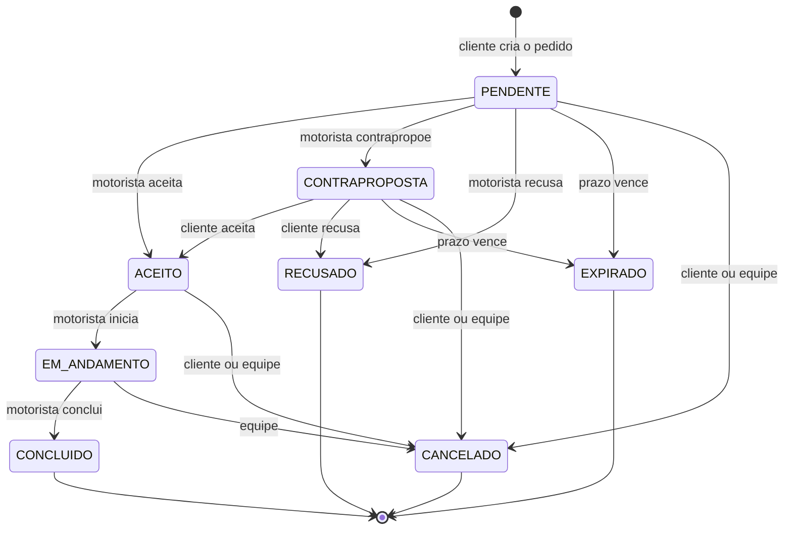
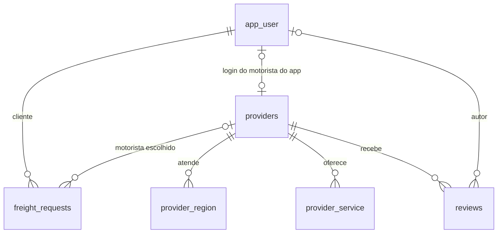

# FreteHub — Relatorio do estado atual

Data: 16/10/2026. Versao descrita: commit `024d850`, no branch
`motoristas-e-fluxo-de-aceite`. O site publicado ainda roda a versao anterior
(secao 11).

Este relatorio resume o que a aplicacao faz hoje e o que mudou no escopo,
como apoio para revisar a monografia. Os detalhes estao na
[documentacao tecnica](documentacao-tecnica.md); as referencias "§N" apontam
para as secoes dela.

## 1. Resumo

O FreteHub e uma aplicacao web para contratar frete urbano e pequenas
mudancas, com demonstracao na Baixada Santista. A versao anterior era um
catalogo com curadoria: a equipe validava os prestadores, que nao tinham
login, e o cliente negociava tudo fora da plataforma.

A pedido da orientadora, a aplicacao passou a um **modelo hibrido**:

- **Motoristas do app (`INTERNO`)** tem login, informam se estao disponiveis
  e respondem aos pedidos dentro de um prazo: aceitam, recusam ou fazem uma
  contraproposta de valor.
- **Motoristas de contato direto (`EXTERNO`)** continuam como diretorio, com
  contato por WhatsApp ou telefone, para manter a cobertura desde o inicio.

Os dois tipos passam pela mesma curadoria. O FreteHub registra a oferta e o
valor combinado, mas nao processa pagamento.

## 2. Mudancas de escopo

### 2.1 Antes e agora

| Aspecto | Versao anterior | Versao atual |
| --- | --- | --- |
| Proposta | Catalogo com curadoria | Catalogo com curadoria e contratacao pelo app |
| Quem presta o servico | "Prestador", sempre sem login | "Motorista": do app (`INTERNO`, com login) ou de contato direto (`EXTERNO`, sem login) |
| Papeis com login | `CLIENTE` e `ADMIN` | `CLIENTE`, `MOTORISTA` e `ADMIN` |
| Valor do frete | Nao registrado; combinado por fora | O cliente oferece um valor; o motorista aceita, recusa ou contrapropoe; o valor combinado fica gravado |
| Quem move o pedido | A equipe, um passo por vez; o cliente so cancelava | Cliente e motorista, pelas acoes do fluxo; a equipe modera |
| Status do pedido | `ABERTA`, `EM_NEGOCIACAO`, `CONFIRMADA`, `CONCLUIDA`, `CANCELADA` | `PENDENTE`, `CONTRAPROPOSTA`, `ACEITO`, `RECUSADO`, `EXPIRADO`, `EM_ANDAMENTO`, `CONCLUIDO`, `CANCELADO` |
| Prazo de resposta | Nao havia | 30 minutos, configuravel; vencido o prazo, o pedido expira |
| Pedido sem motorista escolhido | Ficava `ABERTA`, sem encaminhamento | Vai para a fila da cidade: o primeiro motorista disponivel que aceitar leva |
| Dados do pedido | Origem, destino, data e descricao da carga | Tambem cidade, horario, telefone do cliente, valor oferecido, contraproposta, valor combinado e prazo |
| Disponibilidade | Nao havia | O motorista do app liga e desliga o recebimento de pedidos |
| Contatos | Sempre publicos no perfil | Contato direto: publicos. Motorista do app: liberados as duas partes so depois do aceite |
| Documentos | Nota interna da equipe | Nota interna e marcador "documentos verificados" (CNH e CRLV), ligado na aprovacao |
| Avaliacoes | Qualquer usuario logado | So clientes, uma por motorista |
| Aviso de novidades | Nao havia | Paineis atualizados a cada 10 s e contador no menu |
| Termo nas telas | "Prestador" | "Motorista"; as URLs antigas redirecionam |

### 2.2 O que continua igual

- Curadoria com quatro status de cadastro: `PENDENTE`, `APROVADO`,
  `REJEITADO` e `INATIVO`. So aprovados aparecem no catalogo.
- Catalogo publico com busca, filtros e paginacao.
- Avaliacoes com nota de 1 a 5 e comentario.
- Tecnologias, arquitetura em tres camadas e publicacao no Render com banco
  no Neon.
- Design system e criterios de acessibilidade da interface.
- Sem pagamento, comissao, chat ou mapas.

### 2.3 Entregas pedidas pela orientadora

| Entrega | Situacao | Onde ver |
| --- | --- | --- |
| Diagrama ER e schema | Feito | §6.1 e a migration `V2__motoristas_e_fluxo_de_aceite.sql` |
| DTOs e endpoints: cadastro e login do motorista; criar, aceitar e recusar pedido | Feito; inclui tambem contraproposta, fila, inicio, conclusao e cancelamento | §8 e [`web/Dtos.java`](../backend/src/main/java/com/fretehub/web/Dtos.java) |
| Front com "Contratar no App" x "Contato Direto", painel do motorista e painel do cliente | Feito | `/catalogo`, `/painel-motorista` e `/meus-fretes` |

### 2.4 Em numeros

| Indicador | Antes | Agora |
| --- | --- | --- |
| Papeis com login | 2 | 3 |
| Status do pedido | 5 | 8 |
| Endpoints da API | 14 | 26 |
| Telas | 10 | 11 |
| Testes automatizados de API | 30, em 5 classes | 62, em 11 classes |
| Migrations do banco | 1 | 2 |

## 3. Perfis e funcionalidades

**Visitante (sem login)**

- Navega pelo catalogo e pelos perfis aprovados, com os selos "Contratar no
  App" e "Contato Direto".
- Fala com motoristas de contato direto por WhatsApp ou telefone.
- Cria uma conta de cliente ou se cadastra como motorista.

**Cliente**

- Abre um pedido para um motorista do app ou para a fila da cidade.
- Acompanha os pedidos em "Minhas solicitacoes", com o prazo restante e a
  trilha de andamento.
- Aceita ou recusa a contraproposta e cancela o pedido antes do inicio do
  frete.
- Depois de uma recusa ou expiracao, tenta outro motorista ou envia o pedido
  para a fila, com o formulario ja preenchido.
- Ve o WhatsApp e o telefone do motorista depois do aceite e avalia
  motoristas.

**Motorista do app (`INTERNO`, papel `MOTORISTA`)**

- Cadastra-se com e-mail e senha, marcando "Receber pedidos pelo app", e
  aguarda a aprovacao.
- Depois de aprovado, liga ou desliga a disponibilidade no painel.
- Recebe os pedidos dirigidos a ele e os da fila das cidades que atende.
- Num pedido direto, aceita, recusa ou contrapropoe; na fila, aceita pelo
  valor oferecido.
- Ve o telefone e o e-mail do cliente depois do aceite, inicia e conclui o
  frete.

**Motorista de contato direto (`EXTERNO`)**

- Cadastra-se sem login; depois de aprovado, aparece no catalogo com WhatsApp
  e telefone.
- Nao recebe pedidos pelo app: preco e detalhes sao combinados fora da
  plataforma.

**Equipe (`ADMIN`)**

- Faz a curadoria: aprova, rejeita, inativa e reativa, com nota interna.
  Aprovar marca os documentos como verificados.
- Ve todos os pedidos e cancela os que ainda nao terminaram (moderacao).
- Avanca ate a conclusao os pedidos herdados da versao anterior, cujo
  motorista nao usa o app.

## 4. Fluxo do pedido

| Acao | Quem | De | Para |
| --- | --- | --- | --- |
| Criar | Cliente | — | `PENDENTE` |
| Aceitar | Motorista escolhido ou da fila | `PENDENTE` | `ACEITO` |
| Recusar | Motorista escolhido | `PENDENTE` | `RECUSADO` |
| Contrapropor | Motorista escolhido | `PENDENTE` | `CONTRAPROPOSTA` |
| Aceitar ou recusar a contraproposta | Cliente | `CONTRAPROPOSTA` | `ACEITO` ou `RECUSADO` |
| Prazo vencido | Sistema | `PENDENTE` ou `CONTRAPROPOSTA` | `EXPIRADO` |
| Iniciar | Motorista do pedido | `ACEITO` | `EM_ANDAMENTO` |
| Concluir | Motorista do pedido | `EM_ANDAMENTO` | `CONCLUIDO` |
| Cancelar | Cliente | `PENDENTE`, `CONTRAPROPOSTA` ou `ACEITO` | `CANCELADO` |
| Moderar | Equipe | Qualquer status nao final | `CANCELADO` |

`RECUSADO`, `EXPIRADO`, `CONCLUIDO` e `CANCELADO` sao finais. O mesmo fluxo
em diagrama de estados:

## 5. Regras de negocio

- **Curadoria.** Todo cadastro nasce `PENDENTE` e so aparece no catalogo
  depois de `APROVADO`. A aprovacao registra que a equipe conferiu a CNH e o
  CRLV. Sair de `APROVADO` desliga a disponibilidade.
- **Quem recebe pedido.** So o motorista do app aprovado e disponivel recebe
  pedido novo, direto ou pela fila. O motorista de contato direto nunca
  recebe pedido pelo app. Um pedido ja recebido pode ser respondido mesmo que
  o motorista fique indisponivel depois, desde que continue aprovado.
- **Dados obrigatorios.** Cidade, origem, destino, descricao da carga (10
  caracteres ou mais), data e horario futuros, telefone e valor oferecido,
  entre R$ 0,01 e R$ 100.000,00. Veiculo e servico sao opcionais. O horario e
  interpretado no fuso de Brasilia.
- **Prazo.** O motorista tem 30 minutos para responder; o valor e
  configuravel. A contraproposta abre um novo prazo, agora para o cliente.
  Vencido o prazo, o pedido vira `EXPIRADO` quando e consultado; nao ha tarefa
  agendada.
- **Contraproposta.** So em pedido direto, com valor positivo e diferente da
  oferta. Ha uma rodada: o cliente aceita ou recusa.
- **Fila da cidade.** O pedido sem motorista escolhido aparece para os
  motoristas aprovados e disponiveis que atendem a cidade. Na fila so existe
  "Aceitar", pelo valor oferecido. O primeiro aceite vence, e quem tenta
  depois recebe um erro de conflito.
- **Cidade.** E o trecho antes de " - " na regiao atendida (em
  "Santos - Gonzaga", a cidade e Santos), comparado sem acentos e sem
  diferenciar maiusculas.
- **Privacidade.** O catalogo nao mostra o contato dos motoristas do app, e a
  fila nao mostra o telefone do cliente. Depois do aceite, o cliente ve o
  WhatsApp e o telefone do motorista, e o motorista ve o telefone e o e-mail
  do cliente.
- **Nova tentativa.** Recusado e expirado sao finais. Uma nova tentativa cria
  outro pedido, ja preenchido, e o anterior fica no historico.
- **Cancelamento.** O cliente cancela enquanto o frete nao comecou
  (`PENDENTE`, `CONTRAPROPOSTA` ou `ACEITO`). Depois disso, so a equipe.
- **Avaliacao.** So clientes avaliam, com nota de 1 a 5 e comentario, uma vez
  por motorista.
- **Pagamento.** Acontece fora da plataforma; o FreteHub so registra o valor
  combinado.

## 6. Arquitetura

A aplicacao tem tres camadas: o front (aplicacao React de pagina unica), a
API REST (Spring Boot) e o banco (PostgreSQL). Front e API trocam JSON por
HTTP.

- **Autenticacao sem sessao.** Token JWT assinado, valido por 12 horas.
  Senhas guardadas com BCrypt. Cada rota restrita exige um papel, e os servicos
  conferem se a pessoa e dona do pedido ou o motorista dele.
- **Organizacao por assunto.** `user` (contas e login), `provider`
  (motoristas, curadoria, avaliacoes e painel do motorista) e `freight`
  (pedidos e fluxo de aceite), alem de `security`, `config`, `web` (DTOs e
  erros) e `seed`. Cada assunto tem controller, service, repository e
  entidade.
- **Disputa na fila.** Controle de concorrencia otimista (`@Version`): de
  dois aceites simultaneos, so o primeiro e gravado.
- **Atualizacao das telas.** Os paineis consultam a API a cada 10 s e quando
  a aba volta ao foco. Nao ha push.
- **Evolucao do banco.** Migrations versionadas com Flyway; na subida, o
  Hibernate confere se as entidades batem com as tabelas.

| Camada | Tecnologias |
| --- | --- |
| Front | React 18, TypeScript, Vite 5, Tailwind CSS v4, React Router v6, TanStack Query v5, Phosphor Icons |
| API | Java 21+, Spring Boot 3.5, Spring Security, Spring Data JPA (Hibernate), Flyway, jjwt |
| Banco | PostgreSQL 16 (Neon na versao publicada) |
| Testes | JUnit 5, MockMvc, H2 |
| Publicacao | Render (site estatico e API em Docker) e Neon |

## 7. Modelo de dados

As tabelas sao `app_user`, `providers`, `provider_region`,
`provider_service`, `reviews` e `freight_requests`. A V2 nao criou tabelas:
acrescentou colunas, restricoes e indices as existentes.

O codigo manteve os nomes que ja existiam. A correspondencia com os nomes do
escopo:

| No escopo | No codigo e no banco |
| --- | --- |
| `Driver` | Entidade `ProviderProfile`, tabela `providers` |
| `FreightRequest` | Entidade `FreightOrder`, tabela `freight_requests` |
| `driver_id` | `provider_id` |
| `cargo_details` | `description` |

Relacionamentos (o diagrama com os campos esta na §6.1):

Colunas novas da V2:

| Tabela | Coluna | Para que serve |
| --- | --- | --- |
| `providers` | `type` | `INTERNO` ou `EXTERNO` |
| | `user_id` | Conta do motorista do app; unica e preenchida so no `INTERNO` |
| | `is_available` | Disponibilidade para novos pedidos |
| | `documents_verified` | CNH e CRLV conferidos na aprovacao |
| `freight_requests` | `city` | Cidade do frete; define a fila |
| | `scheduled_at` | Data e horario em UTC; substitui `scheduled_date` |
| | `contact_phone` | Telefone do cliente, liberado ao motorista apos o aceite |
| | `price_offered`, `counter_price`, `agreed_price` | Oferta, contraproposta e valor combinado |
| | `response_deadline` | Prazo da resposta pendente |
| | `version` | Controle de concorrencia da fila |

A V2 preserva os dados antigos. Os motoristas existentes viram `EXTERNO`. Os
pedidos mudam de status assim: `ABERTA` e `EM_NEGOCIACAO` viram `EXPIRADO`;
`CONFIRMADA` vira `ACEITO`; `CONCLUIDA` vira `CONCLUIDO`; `CANCELADA` vira
`CANCELADO`.

## 8. API

Sao 26 endpoints, todos sob `/api`, com JSON. Em erro, a resposta traz
`{ "message": "..." }` e o codigo HTTP (400, 401, 403, 404 ou 409).

| Grupo | Acesso | Rotas |
| --- | --- | --- |
| Autenticacao | Publico | `POST /auth/login`, `/auth/register` e `/auth/register-driver` |
| Catalogo | Publico | `GET /providers`, `/providers/{id}`, `/regions` e `/cities`; `POST /providers` (cadastro de contato direto) |
| Avaliacao | `CLIENTE` | `POST /providers/{id}/reviews` |
| Painel do motorista | `MOTORISTA` | `GET /driver/me`, `PATCH /driver/me/availability`, `GET /driver/freights` e `POST /driver/freights/{id}/` + `accept`, `reject`, `counter-offer`, `start` ou `complete` |
| Pedidos do cliente | `CLIENTE` | `POST /freights`, `GET /freights/mine` e `POST /freights/{id}/` + `cancel`, `counter-offer/accept` ou `counter-offer/reject` |
| Administracao | `ADMIN` | `GET` e `PATCH` em `/admin/providers` e `/admin/freights` |

## 9. Telas

| Rota | Tela | Quem acessa | O que mudou |
| --- | --- | --- | --- |
| `/` | Inicio | Todos | Textos explicam o modelo hibrido |
| `/catalogo` | Catalogo | Todos | Selos e filtro "Forma de contratacao" |
| `/motorista/:id` | Perfil do motorista | Todos | Contato direto ou botao de pedido, conforme o tipo |
| `/seja-motorista` | Cadastro de motorista | Todos | Opcao "Receber pedidos pelo app" |
| `/login` e `/cadastro` | Entrar e criar conta | Todos | O login leva ao painel de cada papel |
| `/solicitar` | Solicitar frete | Cliente | Cidade, horario, valor e telefone; motorista do app ou fila |
| `/meus-fretes` | Minhas solicitacoes | Cliente | Prazo, contraproposta, trilha, contatos e nova tentativa |
| `/painel-motorista` | Painel do motorista | Motorista | Tela nova: disponibilidade, pedidos, aceite e andamento |
| `/admin` | Painel da equipe | Admin | Tipo, documentos e moderacao de pedidos |

Ha tambem a pagina 404, e as URLs antigas (`/prestador/:id`,
`/seja-prestador`) redirecionam para as novas. A interface funciona no
celular e no desktop.

## 10. Qualidade e verificacao

**Testes automatizados.** Sao 62 testes de API (eram 30). Cada teste sobe a
aplicacao e faz requisicoes HTTP simuladas (MockMvc), com um banco H2 em
memoria.

| Classe | Testes | O que cobre |
| --- | --- | --- |
| `AuthApiTest` | 7 | Cadastro e login, inclusive do motorista |
| `DriverAccountApiTest` | 6 | Conta do motorista, disponibilidade e acesso por papel |
| `ProviderCurationApiTest` | 12 | Curadoria, documentos, contatos publicos e nota interna |
| `FreightFlowApiTest` | 9 | Criacao, oferta, contraproposta, posse, cancelamento e andamento |
| `FreightQueueApiTest` | 4 | Fila por cidade, aceite simultaneo e privacidade |
| `FreightExpiryApiTest` | 4 | Expiracao e bloqueio de resposta fora do prazo |
| `FreightStatusApiTest` | 7 | Moderacao e apoio da equipe |
| `ContactVisibilityApiTest` | 3 | Contatos antes e depois do aceite |
| `ReviewApiTest` | 5 | Avaliacao so por cliente, unica e com nota valida |
| `ErrorMappingApiTest` | 3 | Entrada invalida respondida com 400 |
| `CorsApiTest` | 2 | Origens permitidas e bloqueadas |

**Banco real.** Os testes usam H2, entao a migration V2 foi validada a parte
no PostgreSQL, sobre dados da versao anterior e num banco vazio. Foram
conferidos os status convertidos, as datas e o aceite simultaneo da fila:
uma resposta 200 e outra 409.

**Ponta a ponta no navegador.** O teste usou cliente e motorista em sessoes
separadas, com capturas de tela no desktop e no celular. Foram 17
verificacoes do fluxo principal e 2 da expiracao, todas aprovadas, sem erros
no console nem falhas de requisicao. O roteiro cobriu:

- os selos do catalogo;
- o cadastro do motorista, a aprovacao e a disponibilidade;
- o pedido direto, a contraproposta, os contatos, o inicio, a conclusao e a
  avaliacao;
- a recusa, o reenvio para a fila e o aceite por um segundo motorista;
- a expiracao, com prazo de 1 minuto.

Tempos medidos:

- o pedido direto apareceu no painel do motorista em 8,8 s;
- a contraproposta chegou ao cliente em 8,3 s;
- a disponibilidade foi liberada 5,8 s depois da aprovacao.

Todos ficaram dentro do ciclo de atualizacao de 10 s.

**Front.** O build de producao e a checagem de tipos passam sem erros.

**Acessibilidade.**

- Contraste minimo de 4.5:1 (WCAG AA) e foco sempre visivel.
- Areas de toque de 44 px e rotulo em todos os campos.
- Status com icone e texto, nunca so por cor.
- Interruptor de disponibilidade com `role="switch"`.
- Avisos para leitor de tela com o numero de pedidos e contrapropostas que
  aguardam resposta.

**Seguranca.**

- Senhas com BCrypt e token JWT assinado.
- Permissao por papel nas rotas restritas e checagem de dono nos servicos.
- CORS restrito ao endereco do site e segredos fora do codigo.

## 11. Publicacao

- O endereco publico (https://fretehub-web.onrender.com) ainda roda a
  **versao anterior**. A versao descrita aqui esta num branch local
  (`motoristas-e-fluxo-de-aceite`), que ainda nao foi enviado ao GitHub nem
  publicado.
- Publicar significa levar o branch para a `main`, o que dispara o deploy no
  Render, e a V2 roda sozinha no Neon. Para as contas novas de motorista
  existirem online, o banco do Neon precisa ser zerado uma vez. Isso apaga os
  dados criados online, entao convem fazer um backup antes.
- No plano gratuito, a API dorme apos 15 minutos sem acesso e leva de 1 a 2
  minutos para acordar. Antes de uma apresentacao, abra o site alguns minutos
  antes.

## 12. Limitacoes e visao futura

**Limitacoes conhecidas**

- O aviso de novidades e uma consulta a cada 10 s; nao ha push, e-mail nem
  SMS.
- A expiracao acontece quando o pedido e consultado, sem tarefa agendada.
- Ha uma unica rodada de contraproposta.
- Avaliacoes nao exigem um frete concluido com o motorista.
- A curadoria aceita qualquer troca de status e nao registra quem mudou nem
  quando.
- O cadastro e publico e nao tem limite de envios.
- O token fica no `localStorage` e nao e renovado: depois de 12 horas, e
  preciso entrar de novo. A alternativa mais segura seria um cookie
  `HttpOnly`.
- O filtro do catalogo roda em memoria, o que atende algumas centenas de
  motoristas.
- Nao ha integracao continua: os testes nao rodam antes do deploy.
- Ajustes de interface observados nos testes:
  - cancelar um pedido nao pede confirmacao;
  - nao ha atalho para avaliar o motorista depois da conclusao;
  - o motorista que recusou um pedido direto pode ve-lo de novo na fila, se
    o cliente o reenviar.

**Visao futura**

Push em tempo real (SSE ou WebSocket), e-mail ou SMS, chat, rastreio por
GPS, mapas, preco por distancia e pagamento. Tambem ficam para depois:

- upload de documentos e fotos;
- edicao do perfil pelo proprio motorista;
- mais rodadas de contraproposta;
- desistencia do motorista depois do aceite;
- varios veiculos por motorista;
- limite de cadastros por IP.

## 13. Dados de demonstracao

Na primeira subida, um banco vazio recebe estas contas:

| Perfil | E-mail | Senha |
| --- | --- | --- |
| Admin | admin@fretehub.com | admin123 |
| Cliente | cliente@fretehub.com | cliente123 |
| Motorista do app, aprovado e disponivel (Carlos Transportes) | motorista@fretehub.com | motorista123 |
| Motorista do app, aprovado e indisponivel (Ana Express Moto) | ana@fretehub.com | motorista123 |
| Motorista do app, em analise (Pedro Carretos) | pedro@fretehub.com | motorista123 |

O banco recebe tambem tres motoristas de contato direto, dois aprovados e um
em analise. Ha ainda tres pedidos do cliente demo: um aceito, um concluido e
um expirado. As regioes cobrem cidades como Santos, Sao Vicente e Praia
Grande. Na versao publicada, as contas de motorista so passam a existir
depois de zerar o Neon (secao 11).

## Onde aprofundar

- [README](../README.md): visao geral, como rodar e funcionalidades.
- [Documentacao tecnica](documentacao-tecnica.md):
  - §1: modelo hibrido;
  - §5.7: fluxo do pedido;
  - §6.1: diagrama ER completo;
  - §6.2: migrations;
  - §7: seguranca;
  - §8: API;
  - §9.2: telas;
  - §9.8: design system e acessibilidade;
  - §10: fluxos de ponta a ponta;
  - §11: testes;
  - §12: limitacoes.
